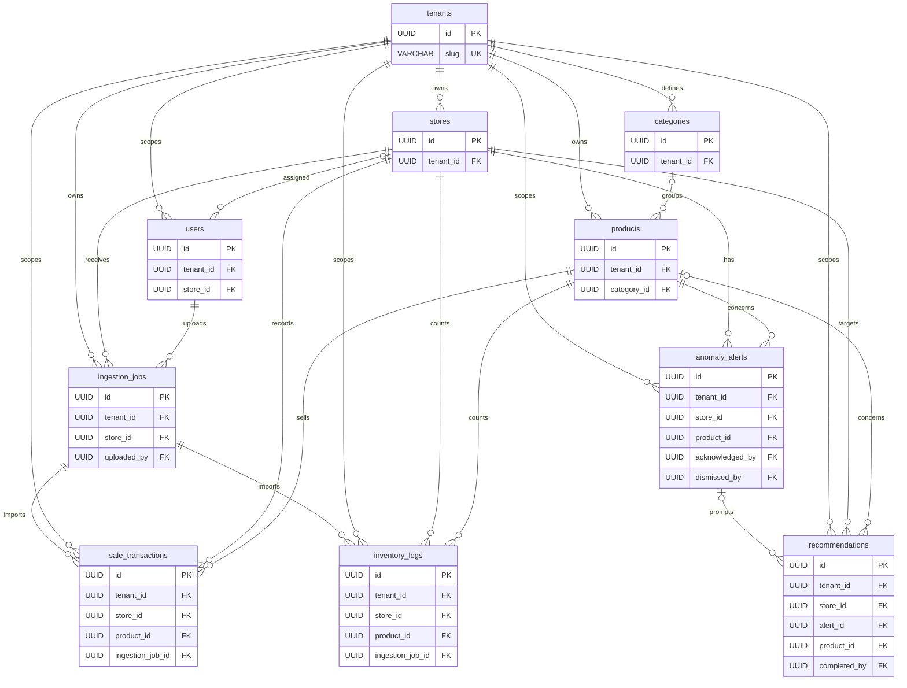

# HisaabIQ FYP Report Evidence

Evidence collected from the checked-out repository and the safe local checks listed below. No production service or database was contacted. `FOUND IN CODE` and `NOT FOUND / COULD NOT RUN` are source-based findings, not runtime claims.

## Part A — Test matrix evidence

Fixture files found under `C:\Users\Nofal Zia\Desktop\FYP Test files`: `test_valid.csv`, `test_missing_date.csv`, and `test_wrong_type.txt`. No upload was sent: `backend\.env` exists, its database destination was not inspected, and the task prohibits database writes. Therefore no result below claims an upload, alert run, or data-integrity outcome was observed.

| Test | Expected | Actual evidence |
|---|---|---|
| T1 Valid sales CSV | Job completes, counts accepted rows, automatically runs analysis. | **COULD NOT RUN.** The fixture has the recognized sales header. Code returns a job ID and later calls `runAnalysis` after rows are written; this is not an observed upload result. `backend/src/routes/upload.js:157-243,767-778`. |
| T2 Missing date | Clear missing-column error; no partial sales-row write. | **COULD NOT RUN.** The fixture omits the date header. Code checks required headers before row streaming and fails the job with `MISSING_COLUMNS` in `error_log`; the job record is still created, but this path writes no sales rows. `backend/src/routes/upload.js:461-500`. |
| T3 Wrong type / bad row | Unsupported file is rejected; for a supported CSV with a bad row, log that row and import valid remaining rows. | **COULD NOT RUN.** Supplied `test_wrong_type.txt` has an unsupported extension; upload accepts `.csv`, `.xlsx`, `.xls`. For supported sales files, code accumulates row errors and continues; the job records `rows_failed` and up to 100 errors. No row-level malformed-CSV fixture was found among the supplied files. `backend/src/routes/upload.js:111-115,721-733,800-810`. |
| T4 Same valid file twice | Second upload rejected by file hash. | **COULD NOT RUN.** Code calculates SHA-256; an existing tenant/store/hash returns HTTP 409 `DUPLICATE_FILE`; a partial unique index handles concurrent duplicates. Failed jobs are excluded. `backend/src/routes/upload.js:190-235,994-1018`; `backend/db/schema.sql:235-237`. |
| T5 Detection twice | Second run adds zero duplicate alerts (and no duplicate alert-linked recommendations). | **COULD NOT RUN.** Code uses `ON CONFLICT ... DO NOTHING` for alert inserts; recommendation uniqueness is on `alert_id`; orchestration documents the expected second-run 0/0 on unchanged data. `backend/src/services/detectionEngine.js:184,292,379`; `backend/src/services/analysisRunner.js:20-25`; `backend/db/schema.sql:341-344,376`. |
| T6 Clerk role | Identify API and UI access. | **FOUND IN CODE:** `data_entry_clerk` is routed to `CashierWorkspace`, not the dashboard shell (`src/App.jsx:15-44`). Dashboard reads allow owner/manager/system_admin only; clerk requests are denied 403. Alert/recommendation mutations and manual runs allow manager/owner only. Authenticated upload, job status, and job summary have no role middleware, so clerk access is allowed there. `backend/src/middleware/auth.js:70-88`; route guards in the route files listed in Part B. |
| T7 Empty tenant | Identify UI components with empty states. | **FOUND IN CODE:** empty/demo and successful-empty branches exist in Owner Overview, Manager Analytics, Stockout Watch, and Recommendations; Stockout Watch also distinguishes missing inventory. See `src/components/dashboard/BusinessOwnerDashboard.jsx:598-626`, `StoreManagerDashboard.jsx:969-975`, `StockoutPrediction.jsx:298-339`, `RecommendationsPanel.jsx:430-461`. No empty-tenant browser/API runtime was performed. |
| T8 Expired/invalid JWT | API status/body and frontend response. | **FOUND IN CODE:** missing/malformed bearer header -> 401 `UNAUTHORIZED`; expired -> 401 `TOKEN_EXPIRED`; other invalid JWT -> 401 `INVALID_TOKEN`. Any API 401 dispatches `rad:unauthorized`; AuthContext drops auth state and returns to login, whose expired-session notice is shown. Boot rejects expired/unreadable token/session pairs. `backend/src/middleware/auth.js:18-54`; `src/api/client.js:20-23,36-44`; `src/context/AuthContext.jsx:120-160,219-238`; `src/components/auth/LoginScreen.jsx:129-143`. |
| T9 Large import | Locate existing benchmark evidence; do not rerun >=100k rows. | **FOUND IN CODE / recorded documentation:** existing parse and end-to-end values are in `docs/validation/ingestion_benchmark.md` and `.csv`; scripts are `backend/scripts/benchmark/runParseBenchmark.js` and `runIngestionBenchmark.js`. Nothing >=100k was rerun. Parse (stream seconds / peak RSS MB): 100k 0.32 / 50.0; 250k 0.71 / 54.4; 500k 1.21 / 54.6; 1m 2.47 / 61.6. E2E: 10k 6.9s, 1,458 rows/s, 10,000 processed/0 failed; 50k 15.9s, 3,142 rows/s, 50,000/0; 100k 28.4s, 3,518 rows/s, 100,000/0. Recorded health p95: 157, 175, 164 ms respectively. The document describes a validation sandbox and remote DB latency; these are its recorded results, not this session's measurements. |

### Additional safe local checks

**OBSERVED — database-free backend self-tests** (CMD, run from `backend\`):

```text
npm run test:zscore
✅ rollingZScore self-test passed (5/5)
npm run test:validators
✅ validators self-test passed
npm run test:upload-progress
✅ upload progress self-test passed
npm run test:holt-winters
✅ holtWinters self-test passed
npm run test:iforest
✅ isolationForest self-test passed
```

Across these five scripts, 78 PASS assertions were printed and no FAIL assertion was printed. The root package has no `test` script; the backend exposes the five individual self-test scripts above. Database smoke/validation scripts were not run.

**OBSERVED — frontend build** (CMD, repository root):

```text
npm run build
vite v8.1.4 building client environment for production...
✓ 36 modules transformed.
✓ built in 5.13s
```

**OBSERVED — frontend lint** (CMD, repository root): exit code 0; 21 warnings, including unused imports/variables and React Fast Refresh / hook-dependency warnings. Trimmed exact output:

```text
npm run lint
backend/src/routes/upload.js:79:17: warning eslint(no-unused-vars): Identifier 'getClient' is imported but never used.
src/components/dashboard/StoreManagerDashboard.jsx:951:5: warning react-hooks(exhaustive-deps): React Hook useEffect has a missing dependency: 'fetchAlerts'
```

## Part B — Documentation facts

### 1. Git facts

**OBSERVED:** checked-out branch `feature/hisaabiq-ml`, clean before this evidence file was created; no branch switch or commit. `git rev-list --all --count` returned 120. Reachable commits by local branch: `feature/hisaabiq-ml` 58; `main` 49; `phase2-backend` 22; `agents/design-system-refinements-ui-ux` 1; `agents/melted-mackerel` 1. Remote-tracking counts: `origin/feature/hisaabiq-ml` 58, `origin/main` 49, `origin/phase2-backend` 22. These counts overlap through shared history and are not additive.

`git shortlog -sne --all`:

| Author entry | Commits | First–last authored date |
|---|---:|---|
| Your Name `<nofalzia4s@gmail.com>` | 109 | 2026-07-09 – 2026-11-21 |
| VS Code `<vscode@users.noreply.github.com>` | 6 | 2026-07-10 – 2026-07-10 |
| Nofal Zia `<nofalzia4s@gmail.com>` | 5 | 2026-11-20 – 2026-11-21 |

The two name entries for the same email are preserved as Git reports them. Overall repository date range: 2026-07-09 – 2026-11-21.

Selected milestone commits (message, short hash, authored date):

| Date | Hash | Message |
|---|---|---|
| 2026-10-12 | `cfc8623` | T8a+T8b: file-level upload dedup, idempotent seed, ingestion benchmark |
| 2026-10-12 | `ffb0ecc` | T8c: Enhance ingestion performance and rate limiting |
| 2026-10-13 | `2ab1efc` | T10a (bakery): add seed script for London Bakers I-10 tenant and provenance documentation |
| 2026-10-15 | `104baba` | T11a: Enhance role-based access control and add summary endpoint for upload jobs |
| 2026-11-14 | `e1c64e8` | T12a: Enhance data ingestion validation and reporting |
| 2026-11-15 | `85f3d50` | T12d: Implement automatic analysis execution during data import, enhancing alerts and recommendations handling |
| 2026-11-16 | `04ebdda` | T12g: Add onboarding demo tenant and related scripts for data management |
| 2026-11-17 | `dfcb3b9` | feat(forecast): Holt-Winters demand engine behind FORECAST_ENGINE |
| 2026-11-17 | `445e9d9` | feat(detection): pure-JS Isolation Forest validated against rolling z-score v2 |
| 2026-11-17 | `a020115` | docs: rename the product to HisaabIQ and publish the forecasting evidence |
| 2026-11-20 | `3bcf3b8` | fix(env): update API URL to production endpoint |

### 2. Code size

**OBSERVED:** small Node file walk, counting UTF-8 lines approximately (a trailing newline may count as an extra line); excludes `node_modules`.

| Area | Files | Approx. lines |
|---|---:|---:|
| Frontend `src\` | 20 | 7,854 |
| Backend `backend\src\` | 22 | 5,755 |
| DB migrations `backend\db\migrations\` | 4 | 126 |
| `docs\` | 38 | 17,252 |

### 3. Full database schema

**FOUND IN CODE:** authoritative DDL is `backend/db/schema.sql:59-473`; migrations `002`–`005` extend/align it. All nine business tables have a UUID primary key. Column types and table-specific keys are below; omitted `NOT NULL` means nullable in the DDL.

| Table | Columns (type; `*` = PK) | Foreign keys / unique / checks |
|---|---|---|
| `tenants` | `id UUID*`, `name VARCHAR(255)`, `slug VARCHAR(100)`, `currency_code CHAR(3)`, `locale VARCHAR(20)`, `brand_accent VARCHAR(9)`, `is_active BOOLEAN`, `created_at TIMESTAMPTZ`, `updated_at TIMESTAMPTZ` | `slug` UNIQUE |
| `users` | `id UUID*`, `tenant_id UUID`, `email VARCHAR(320)`, `password_hash VARCHAR(255)`, `role VARCHAR(50)`, `store_id UUID`, `is_active BOOLEAN`, `last_login_at TIMESTAMPTZ`, `created_at TIMESTAMPTZ`, `updated_at TIMESTAMPTZ` | `tenant_id→tenants.id`; `store_id→stores.id ON DELETE SET NULL`; UNIQUE `(tenant_id,email)`; role check: owner/manager/data_entry_clerk/system_admin |
| `stores` | `id UUID*`, `tenant_id UUID`, `name VARCHAR(255)`, `location VARCHAR(500)`, `is_active BOOLEAN`, `created_at TIMESTAMPTZ`, `updated_at TIMESTAMPTZ` | `tenant_id→tenants.id` |
| `categories` | `id UUID*`, `tenant_id UUID`, `name VARCHAR(255)`, `description TEXT`, `is_active BOOLEAN`, `created_at TIMESTAMPTZ`, `updated_at TIMESTAMPTZ` | `tenant_id→tenants.id`; UNIQUE `(tenant_id,name)` |
| `products` | `id UUID*`, `tenant_id UUID`, `category_id UUID`, `name VARCHAR(255)`, `sku VARCHAR(100)`, `standard_unit_cost NUMERIC(15,2)`, `standard_unit_price NUMERIC(15,2)`, `reorder_threshold INTEGER`, `is_active BOOLEAN`, `created_at TIMESTAMPTZ`, `updated_at TIMESTAMPTZ` | `tenant_id→tenants.id`; `category_id→categories.id ON DELETE SET NULL`; UNIQUE `(tenant_id,sku)` |
| `ingestion_jobs` | `id UUID*`, `tenant_id UUID`, `store_id UUID`, `uploaded_by UUID`, `original_filename VARCHAR(500)`, `file_type VARCHAR(10)`, `status VARCHAR(30)`, `total_rows INTEGER`, `rows_processed INTEGER`, `rows_failed INTEGER`, `error_log JSONB`, `column_map JSONB`, `file_hash VARCHAR(64)`, `started_at TIMESTAMPTZ`, `completed_at TIMESTAMPTZ` | FKs `tenant_id→tenants.id`, `store_id→stores.id`, `uploaded_by→users.id`; file type csv/xlsx; status pending/validating/processing/completed/failed |
| `sale_transactions` | `id UUID*`, `tenant_id UUID`, `store_id UUID`, `product_id UUID`, `ingestion_job_id UUID`, `quantity_sold INTEGER`, `unit_price_at_sale NUMERIC(15,2)`, `cost_price_at_sale NUMERIC(15,2)`, `total_revenue NUMERIC(15,2)` generated stored, `total_cost NUMERIC(15,2)` generated stored, `sale_date DATE`, `created_at TIMESTAMPTZ` | FKs `tenant_id→tenants.id`, `store_id→stores.id`, `product_id→products.id`, `ingestion_job_id→ingestion_jobs.id`; quantity > 0; price/cost >= 0 |
| `inventory_logs` | `id UUID*`, `tenant_id UUID`, `store_id UUID`, `product_id UUID`, `ingestion_job_id UUID`, `quantity_on_hand INTEGER`, `log_date DATE`, `created_at TIMESTAMPTZ` | FKs `tenant_id→tenants.id`, `store_id→stores.id`, `product_id→products.id`, `ingestion_job_id→ingestion_jobs.id`; quantity >= 0 |
| `anomaly_alerts` | `id UUID*`, `tenant_id UUID`, `store_id UUID`, `product_id UUID`, `alert_type VARCHAR(50)`, `severity VARCHAR(20)`, `title VARCHAR(255)`, `description TEXT`, `metric_value NUMERIC(15,4)`, `threshold_value NUMERIC(15,4)`, `z_score NUMERIC(8,4)`, `alert_date DATE`, `acknowledged_at TIMESTAMPTZ`, `acknowledged_by UUID`, `dismissed_at TIMESTAMPTZ`, `dismissed_by UUID`, `created_at TIMESTAMPTZ` | FKs `tenant_id→tenants.id`, `store_id→stores.id`, `product_id→products.id`, `acknowledged_by→users.id`, `dismissed_by→users.id`; severity info/warning/critical; UNIQUE `(tenant_id,store_id,product_id,alert_type,alert_date)` |
| `recommendations` | `id UUID*`, `tenant_id UUID`, `store_id UUID`, `alert_id UUID`, `product_id UUID`, `rec_type VARCHAR(40)`, `priority INTEGER`, `title VARCHAR(255)`, `body TEXT`, `suggested_quantity INTEGER`, `revenue_at_risk NUMERIC(15,2)`, `due_date DATE`, `completed_at TIMESTAMPTZ`, `completed_by UUID`, `created_at TIMESTAMPTZ`, `updated_at TIMESTAMPTZ` | FKs `tenant_id→tenants.id`, `store_id→stores.id`, `alert_id→anomaly_alerts.id ON DELETE SET NULL`, `product_id→products.id ON DELETE SET NULL`, `completed_by→users.id ON DELETE SET NULL`; priority 1–10; UNIQUE `(alert_id)` |

Indexes and indexed columns: `idx_users_tenant_id(tenant_id)`, `idx_users_email(email)`, `idx_stores_tenant_id(tenant_id)`, `idx_categories_tenant_id(tenant_id)`, `idx_products_tenant_id(tenant_id)`, `idx_products_category_id(category_id)`, `idx_products_sku(tenant_id,sku)`, `idx_ingestion_jobs_tenant_id(tenant_id)`, `idx_ingestion_jobs_status(status)`, `idx_ingestion_jobs_store_id(tenant_id,store_id)`, partial UNIQUE `uq_ingestion_file_per_store(tenant_id,store_id,file_hash) WHERE file_hash IS NOT NULL AND status <> 'failed'`, `idx_sale_tx_tenant_store_date(tenant_id,store_id,sale_date DESC)`, `idx_sale_tx_product_date(tenant_id,product_id,sale_date DESC)`, `idx_sale_tx_ingestion_job(ingestion_job_id)`, `idx_inventory_tenant_store_date(tenant_id,store_id,log_date DESC)`, `idx_inventory_product_date(tenant_id,product_id,log_date DESC)`, `idx_anomaly_tenant_store_date(tenant_id,store_id,alert_date DESC)`, partial `idx_anomaly_tenant_unactioned(tenant_id,acknowledged_at,dismissed_at) WHERE acknowledged_at IS NULL AND dismissed_at IS NULL`, `idx_recommendations_tenant_store(tenant_id,store_id)`, partial `idx_recommendations_tenant_pending(tenant_id,completed_at) WHERE completed_at IS NULL`. The DDL also defines `pgcrypto`, `set_updated_at()` and update triggers on tenants, users, stores, categories, products, recommendations. `backend/db/schema.sql:36-53,71-72,101-102,128-129,155-156,182-183,235-237,273-275,296-297,341-347,376-384`.

Views:

| View | Purpose / output |
|---|---|
| `daily_revenue_by_store` | Per tenant/store/day: store name, transaction count, units, gross revenue, COGS, gross profit. |
| `product_daily_velocity` | Per tenant/store/product/day: product name/SKU, units and revenue. |
| `latest_inventory_per_product` | Latest inventory row per tenant/store/product. |
| `active_anomaly_alerts` | Unacknowledged/undismissed alerts joined to product name/SKU, ordered by severity/date. |

Mermaid relationship diagram (table keys and FK relationships):



### 4. API routes

`requireAuth` means a Bearer JWT is required; dashboard reads additionally allow owner, manager, system_admin. Mutations explicitly guarded by `requireRole` allow only manager/owner. All route facts are **FOUND IN CODE**; no API call was made.

| Method + full path | Auth / roles | Purpose and response |
|---|---|---|
| `GET /health` | N | `SELECT 1`; JSON status/database/timestamp or 503. `backend/src/index.js:101-109` |
| `POST /api/auth/login` | N | Accepts JSON `{email,password,tenantSlug}`; returns `{token,role,tenantId,tenant}`. `backend/src/index.js:125-178` |
| `GET /api/overview` | Y; owner/manager/system_admin | KPI, daily trend, top products, low-stock items. `backend/src/routes/overview.js:47-176` |
| `GET /api/overview/baseline` | Y; owner/manager/system_admin | Scenario baseline or `{baseline:null}`. `overview.js:182-280` |
| `GET /api/alerts` | Y; owner/manager/system_admin | `{alerts,summary,total}`. `backend/src/routes/alerts.js:25-54` |
| `PATCH /api/alerts/:id/ack` | Y; manager/owner | Acknowledge one alert; `{success,alert}`. `alerts.js:57-85` |
| `PATCH /api/alerts/:id/dismiss` | Y; manager/owner | Dismiss one alert; `{success,alert}`. `alerts.js:88-116` |
| `POST /api/alerts/run-detection` | Y; manager/owner | Requires `storeId` query/body; returns run summary and created counts. `alerts.js:123-157` |
| `GET /api/stockout` | Y; owner/manager/system_admin | Requires store; returns as-of date, inventory flag, tiers, products. `backend/src/routes/stockout.js:123-249` |
| `GET /api/forecast` | Y; owner/manager/system_admin | Requires store; per-product demand forecast. `backend/src/routes/forecast.js:44-78` |
| `POST /api/upload` | Y; any authenticated tenant role | Multipart `file` + `storeId`; immediate `202 {jobId,status:"validating"}`, asynchronous processing. Duplicate: `409 {error:"DUPLICATE_FILE",...}`. `backend/src/routes/upload.js:157-243` |
| `GET /api/upload/:jobId/status` | Y; any authenticated tenant role | Job status, counters, `error_log`, column map, assumptions, progress percentage. `upload.js:261-319` |
| `GET /api/upload/:jobId/summary` | Y; any authenticated tenant role | Job kind/status, processed/failed counts, date range, item/unit/revenue totals, top items, analysis. `upload.js:328-426` |
| `GET /api/recommendations` | Y; owner/manager/system_admin | Pending recommendations `{recommendations,total}`. `backend/src/routes/recommendations.js:20-54` |
| `PATCH /api/recommendations/:id/complete` | Y; manager/owner | Complete one recommendation. `recommendations.js:61-87` |
| `POST /api/recommendations/generate` | Y; manager/owner | Requires store; generates recommendations, returns `{inserted}`. `recommendations.js:94-133` |

Upload body is **multipart/form-data**, not JSON: `file` (CSV/XLS/XLSX) and `storeId`; upload response is an asynchronous job handle, not the completed summary. Status and summary response shapes are described in `backend/src/routes/upload.js:254-426`.

### 5. Frontend inventory, roles and design tokens

Tabs are hash views in `DashboardShell`, not router URLs: `#/overview`, `#/deep-analytics`, `#/stockout-prediction`, `#/recommendations`, `#/data-ingestion` (`src/components/layout/DashboardShell.jsx:42-53,128-137`).

| Path | One-line purpose |
|---|---|
| `src/App.jsx` | Auth gate and role-to-workspace/view selection. |
| `src/components/auth/LoginScreen.jsx` | Tenant/email/password login and demo sign-in UI. |
| `src/components/layout/DashboardShell.jsx` | Navigation, role/data-mode preview, shared shell, empty-state primitive. |
| `src/components/cashier/CashierWorkspace.jsx` | Clerk upload steps, progress and completed-job summary. |
| `src/components/ingestion/DataIngestionHub.jsx` | Upload hub and import outcomes. |
| `src/components/dashboard/BusinessOwnerDashboard.jsx` | Overview KPIs, revenue and inventory. |
| `src/components/dashboard/StoreManagerDashboard.jsx` | Analytics, alert actions and scenario panel. |
| `src/components/dashboard/StockoutPrediction.jsx` | Days-of-cover and inventory-risk view. |
| `src/components/dashboard/RecommendationsPanel.jsx` | Recommendations and completion actions. |
| `src/components/ApiErrorNotice.jsx` | API failure and in-flight notices. |
| `src/api/client.js` | Bearer-token API client and upload requests. |
| `src/context/AuthContext.jsx` | Login/logout, token and tenant session state. |
| `src/context/ThemeContext.jsx` | Light/dark themes and design tokens. |
| `src/config/demoTenants.js` | Demo tenant/user directory, no passwords. |
| `src/hooks/useSalesUpload.js` | Upload, polling and job-summary state. |
| `src/utils/salesUpload.js` | Sales upload formatting/template helpers. |
| `src/utils/resolveStoreId.js` | Resolve store scope for API calls. |
| `src/utils/tokenClaims.js` | Read token claims for UI role/session restoration. |
| `src/main.jsx` | React application entry. |
| `src/index.css` | Tailwind theme/font, focus and global styles. |

Role mapping: owner and manager enter `DashboardShell` and get the same five tabs; its preview switcher offers only Owner/Manager and is not server authorization. `data_entry_clerk` enters `CashierWorkspace`. Backend `system_admin` is a valid dashboard-read role but is not in the frontend preview list. `src/App.jsx:15-44`; `DashboardShell.jsx:42-53`.

Demo tenant config: `demo-kiryana` / Demo Kiryana Store; `london-bakers-i10` / London Bakers I-10; `demo-onboarding` / New Store (Demo). Healthy, struggling and new-tenant/no-data are **preview data modes**, not separate tenant slugs (`DashboardShell.jsx:530-534`). `src/config/demoTenants.js:30-62`.

Design tokens from `src/context/ThemeContext.jsx:23-110,112-234`; fonts from `src/index.css:12`:

| Token | Light | Dark |
|---|---|---|
| PALETTE core (`cream`, `sand`, `sandBorder`, `charcoal`, `charcoalMuted`) | `#F4F6F9`, `#F2F5FA`, `rgba(16,24,40,0.07)`, `#0F172A`, `#667085` | `#0E0F13`, `#1F2029`, `rgba(255,255,255,0.09)`, `#F4F5F8`, `#9AA1B2` |
| PALETTE brand (`bottleGreen`, hover, accent) | `#1E362D`, `#294A3D`, `#2E5A49` | `#8B7BFF`, `#A08FFF`, `#8B7BFF` |
| PALETTE remaining tokens | soft `rgba(30,54,45,0.08)`, strong `rgba(30,54,45,0.14)`, accentSoft `rgba(46,90,73,0.10)`, controlHover `#E8EEF7`, rim `rgba(30,54,45,0.22)` | soft `rgba(139,123,255,0.16)`, strong `rgba(139,123,255,0.26)`, accentSoft `rgba(139,123,255,0.16)`, controlHover `#262833`, rim `rgba(139,123,255,0.38)` |
| EARTH (`sage`, `tan`, `terracotta`, `ochre`) | `#12A594`, `#7C5CFA`, `#E5484D`, `#E0A106` | `#4CC9A6`, `#A78BFA`, `#FF6B6B`, `#F2B01E` |
| ALERT_SURFACE | critical `#E5484D` on `rgba(229,72,77,0.10)`; info `#7C5CFA` on `rgba(124,92,250,0.12)`; warning `#E0A106` on `rgba(224,161,6,0.14)` | critical `#FF6B6B` on `rgba(255,107,107,0.14)`; info `#A78BFA` on `rgba(167,139,250,0.16)`; warning `#F2B01E` on `rgba(242,176,30,0.15)` |

Fonts: `"Inter", "Segoe UI Variable", "Segoe UI", ui-sans-serif, system-ui, sans-serif`.

### 6. Dependencies and runtime versions

**FOUND IN CODE:** package manifest version ranges (the versions with `^` are ranges).

- Frontend dependencies: `chart.js ^4.5.1`, `react ^19.2.7`, `react-chartjs-2 ^5.3.1`, `react-dom ^19.2.7`. Dev: `@tailwindcss/postcss ^4.3.2`, `@types/react ^19.2.17`, `@types/react-dom ^19.2.3`, `@vitejs/plugin-react ^6.0.3`, `autoprefixer ^10.5.2`, `oxlint ^1.71.0`, `postcss ^8.5.16`, `tailwindcss ^4.3.2`, `vite ^8.1.1`. `package.json`.
- Backend dependencies: `bcryptjs ^2.4.3`, `cors ^2.8.5`, `csv-parser ^3.0.0`, `dotenv ^16.4.5`, `express ^4.19.2`, `express-rate-limit ^7.3.1`, `helmet ^7.1.0`, `jsonwebtoken ^9.0.2`, `multer ^1.4.5-lts.1`, `pg ^8.12.0`, `xlsx ^0.18.5`; dev `nodemon ^3.1.4`. `backend/package.json`.
- **OBSERVED installed/runtime:** Node `v24.15.0`, npm `11.12.1`, React/React DOM `19.2.7`, Vite `8.1.4`, Tailwind `4.3.2`, Chart.js `4.5.1`. Build output also identified Vite `8.1.4`.

### 7. Environment and deployment

Environment variable **names only** found in app/configuration: `DATABASE_URL`, `JWT_SECRET`, `JWT_EXPIRES_IN`, `PORT`, `NODE_ENV`, `MAX_FILE_SIZE_MB`, `UPLOAD_TEMP_DIR`, `COST_RATIO_DEFAULT`, `CORS_ORIGIN`, `RATE_LIMIT_MAX`, `FORECAST_ENGINE`, `INGEST_DEBUG`, `VITE_API_URL`, `VITE_DEMO_MODE`, `VITE_DEMO_PASSWORD`. No `.env` values are reproduced. Backend `backend/.env` exists; its values were not inspected.

Rate limiting: general `/api` limit defaults to 3000 requests per 15 minutes (`RATE_LIMIT_MAX` override); login is 20 per 15 minutes; upload status polling is exempt from the general limiter. `/health` is outside the API limiter. CORS uses the comma-separated `CORS_ORIGIN` allowlist, allows credentials, methods GET/POST/PATCH/DELETE and headers Content-Type/Authorization/x-tenant-id. `backend/src/index.js:39-98`.

Health endpoint is `GET /health`, unauthenticated, executes `SELECT 1`, returns connected JSON or 503 disconnected (`index.js:101-109`). README describes Vercel frontend and Node-hosted backend; this evidence gathering did not contact either deployment.

Migration instructions in README use CMD syntax `psql "%DATABASE_URL%" -f db/schema.sql`; it explicitly notes `npm run db:migrate` contains `$DATABASE_URL`, which CMD does not expand. Numbered SQL migrations are `backend/db/migrations/002`–`005`; `backend/scripts/runMigration.js` is a separate legacy anomaly constraint migration, not a runner for all numbered files. `backend/package.json:17`; `README.md:273-289`.

### 8. Security facts

**FOUND IN CODE:** passwords are verified with `bcryptjs.compare`; demo seed scripts call bcrypt hash with 10 rounds (`backend/src/index.js:151-159`, `backend/src/seed.js:82`). Login signs JWTs with `JWT_SECRET`; expiry is configurable by `JWT_EXPIRES_IN`, default `7d` (`index.js:157-164`). `helmet()` is applied as middleware (`backend/src/index.js:37`). Rate settings and CORS are in item 7.

Tenant scoping: `requireAuth` verifies the JWT; `resolveTenant` derives `req.tenantId` from its signed claims. Only `system_admin` may supply `x-tenant-id`, which is checked against an active tenant (`backend/src/middleware/auth.js:18-54`; `backend/src/middleware/tenant.js:24-64`). Example tenant-filtered queries: Overview filters `sale_transactions.tenant_id = $1` (`backend/src/routes/overview.js:73-91`); upload verifies `(store id, tenant_id)` (`upload.js:173-183`); alert updates filter `(id, tenant_id)` (`backend/src/routes/alerts.js:67-74`).

### 9. Seed/demo data

**FOUND IN CODE, not database-counted:** `backend/src/seed.js:11-14,27-42,147-200` defines 12 products, 4 categories, two demo users, 90 days × 12 products = 1,080 sale rows, an inventory snapshot of 12 rows, and two ingestion jobs. `backend/db/schema.sql:480-505` seeds one tenant and one store. The seed uses deterministic daily variation.

London Bakers provenance reports 731 days, 50 SKUs, 304,614 source lines, 299,687 kept lines and 36,051 `(date,SKU)` groups; the tenant seed writes no inventory because the source has none (`docs/data/london_bakers_provenance.md:1-10,52-72`; `backend/scripts/bakery/seedTenant.js`).

Demo tenant config lists Demo Kiryana, London Bakers I-10 and New Store (Demo), with role-labelled demo emails but no passwords (`src/config/demoTenants.js:30-62`). Healthy/struggling/no-data are data preview modes for the primary demo, not additional configured tenants. Actual DB tenant existence/counts were not queried.

### 10. Detection and forecasting parameters

- Rolling z-score: 14 prior calendar days per baseline; evaluate latest 14 calendar days; minimum 7 calendar days since first sale; `|z| >= 2.5`, relative deviation `>= 0.25`, absolute deviation `>= 3` units; zero-fill missing sales days; Poisson sigma floor `sqrt(max(mean,1))`. All match the supplied 14-day / 2.5 / 25% / 3 units / Poisson summary. `backend/src/services/rollingZScore.js:25-49,109-129,153-180`; `detectionEngine.js:42-44,80-82,121-131`.
- Isolation Forest defaults: 100 trees, subsample 256 (capped by available samples), product history 14 days, min 30 feature samples, weekday lookback 4 weeks, min 2 same-weekday priors. **Mismatch:** production module `DEFAULT_IFOREST_PARAMS.contamination` is `0.03`, not the summary's `0.025` (`backend/src/services/isolationForest.js:76-87`). The frozen offline validation config/results use contamination `0.025` (`docs/validation/iforest_results.md`, “Frozen settings”). Forest is pure/validated but not wired into the detection engine and writes no alerts (`iforest_results.md`, “What this does and does not show”).
- Stockout risk detector alerts below 7 days. Days of Inventory Left bands: zero stock -> `stockout`; cover `<7` days -> `critical`; `<14` -> `warning`; otherwise `healthy`; no positive demand -> `no_data`. `backend/src/services/detectionEngine.js:42-44,274`; `backend/src/routes/stockout.js:62-71`.
- Shipped forecast default is velocity (last 14 days divided by 14); optional Holt-Winters is additive, season length 7, forecast horizon 7, default history 28 days, minimum scorable history 14 days, zero-filled daily series, non-negative forecast clipping, grid-searches alpha/beta/gamma by in-sample SSE and falls back to velocity when unscorable. Parameter grid: alpha `[0.1..0.8]` by 0.1; beta `[0,0.05,0.1,0.2]`; gamma `[0.1..0.7]` by 0.1. `backend/src/services/forecastService.js:43-53,255-301`; `holtWinters.js:33-54,76-78,181-230`.

### 11. Known issues / unfinished work

- README has unfilled project partner and supervisor TODOs (`README.md:721-722`).
- Isolation Forest is not integrated into production detection, has no severity/explanation/DB alert output; the documentation explicitly says this (`docs/validation/iforest_results.md`).
- Holt-Winters is implemented but `FORECAST_ENGINE` defaults to velocity; README records it lost to velocity in development and hold-out comparisons (`README.md:549`).
- DashboardShell comments identify healthy/struggling/empty preview modes as QA/demo tooling pending real API-driven `hasData` (`src/components/layout/DashboardShell.jsx:526-534`).
- Frontend lint exits 0 but reports 21 warnings; examples are recorded in Part A. `backend/src/routes/alerts.js:5-8` also has a stale header comment saying the run-detection route “will add” the endpoint that is present later in the same file.
- No complete migration runner for numbered migrations `002`–`005` was found; `db:migrate` runs the full schema SQL and `runMigration.js` applies only its one legacy constraint.

## Part C — Screenshot checklist

Do not capture production pages; use the local app and an explicitly local/sandbox DB only. Suggested report screenshots:

| Screen / tab | Tenant and login role | State to capture |
|---|---|---|
| Login | Login screen, signed out | Tenant slug, email and password fields; no secret password visible in the capture. |
| Owner Overview (`#/overview`) | Demo Kiryana, owner | Live seeded KPIs, revenue trend, top products and inventory summary. |
| Manager Analytics (`#/deep-analytics`) | Demo Kiryana, manager | Alerts/analytics and scenario panel. |
| Stock-out Watch (`#/stockout-prediction`) | Demo Kiryana, owner or manager | Ranked products, days left and urgency bands. |
| Recommendations (`#/recommendations`) | Demo Kiryana, manager | Pending recommendations and available completion action. |
| Data Ingestion before upload (`#/data-ingestion`) | New Store (Demo), owner | Blank tenant, upload area and template affordance. |
| Data Ingestion after upload (`#/data-ingestion`) | New Store (Demo), owner | Completed job, row counts, errors/assumptions and automatic-analysis result. |
| Clerk workspace | London Bakers I-10, cashier (`data_entry_clerk`) | One upload-only workspace; include completed job summary but no dashboards. |
| Empty-state screens | New Store (Demo), owner | Capture empty Overview, Analytics, Stockout Watch and Recommendations states; for Stockout distinguish no inventory snapshot. |
| London Bakers tenant | London Bakers I-10, owner | Branded tenant identity with live data; provenance says the seed source has no inventory rows. |
| Theme variant | Any permitted dashboard role | Optional dark-theme capture of one dashboard, showing theme token application. |

## Gaps

- No upload, duplicate-import, detection, JWT endpoint, clerk API, or empty-tenant browser behavior was observed at runtime; these all need an explicitly safe local DB if runtime evidence is required.
- Backend `.env` exists, but its database destination and values were deliberately not read; therefore no backend server/API check was started.
- Actual current database seed counts and which demo tenants are present in any DB remain unverified.
- Deployed environment configuration was not inspected; no production URL was contacted.
- The supplied wrong-type fixture is an unsupported `.txt` file, not a supported CSV containing an invalid row, so T3's row-level continuation case lacks a supplied fixture.
